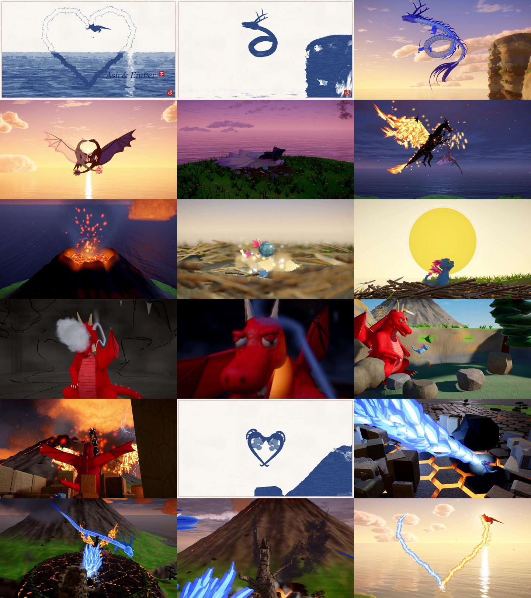

# Ash & Ember

A 140-second live dragon film in one HTML file: pure three.js (r180), no images, models, fonts, samples or network. The picture, the orchestra, the singing and every sound effect are generated in code when the page opens. The audio clock is the film clock, so every wingbeat, step, smoke puff, lava burst, blow and ink stroke lands on the note that plays it.



**Open:** `index.html` (the same file as `dist/ash-and-ember.html` after a build) in Chrome, Safari or Edge. About 2 s to build the world and about 10 s to sing and mix the soundtrack. Click once if the browser asks for sound.

## The story (11 chapters)
Ink prologue (a blue ink loong painted stroke by stroke) → the parents' sunset love flight and their heart → the egg and the lullaby → Cinder's eruption and the fight over the ruined wall → the parents turn to ink smoke → silence and falling ash → dawn: Ember hatches against an enormous sun → Ash's cave (smoke in her face, the twig, the borrowed spark) → rain and the stolen lullaby → training: three falls and a glide → Cinder returns; Ash falls; the memory; Ember's blue fire; the loong; Cinder turns to stone → dawn flight, the heart of fire, the joke, back to ink.

## Keys
- **Tap anything:** it answers.
- **Drag / scroll:** look around and zoom; the camera drifts back on its own.
- **A–;** play the koto on the film's current scale; **B** plays a drum. Live notes land on the next sixteenth and move the world like written ones.
- **1–9, 0:** jump to a chapter. **← / →:** move 5 s.
- **P:** ink. **N:** the scrolling score. **Space:** pause. **M:** mute. **X:** full screen.

## Video
`node tools/render.mjs` renders every frame in headless Chrome with WebCodecs (2880×1620, downsampled to 1920×1080, 60 fps). `node tools/master_test.js` renders the soundtrack with the same code the page runs in its Workers. `python3 tools/finish.py` joins them into a 140 s MP4 that opens on the finished ink painting and loops; loudness is −14 LUFS and −1.7 dBTP.

## Build
```bash
python3 tools/build.py
```
This inlines `vendor/three.*` and `src/*.js` into `dist/ash-and-ember.html`. Score and `src/audio/*` are embedded as the Worker source.
- `--studio NAME files…` builds the core plus those modules only.
- Captures: `tools/capd-ensure.sh`, `tools/shots.sh`, `tools/perf.py`.
- Sound in node: `node tools/master_test.js` writes `qa/master.wav` with loudness numbers.

## Map
| File | What |
|---|---|
| `06_score.js` | the one clock: sections, every note, sung lines (ARPAbet), creature sounds, story cues |
| `16_stage.js` | island marks, shared flight paths (Cinder, the dawn heart), actor registry |
| `40_ember.js` `42_ash.js` `44_pair.js` `46_cinder.js` | the puppets |
| `50_island.js` | crag and nest, volcano, ruined wall, plateau, cave, ledge |
| `10_sky.js` `64_water.js` `66_air.js` | light by film time, sea, clouds, rain, ash, lightning |
| `60_fx.js` | fire, smoke, sparks, eruption, the ink loong, the heart trails |
| `80_post.js` | lens and grade; blue ink-wash mode on rice paper |
| `85_audio.js` + `audio/` | Worker pool: Kelly-Lochbaum singing voices, orchestra, foley, mixer |
| `88_film.js` `89_player.js` | shot list, player |

**Measured:**
- Frame time: 7.6–12.3 ms at 2392×1546.
- Master: −14.05 LUFS, −1.71 dBTP.
- The band plays all 778 written notes and no others.
